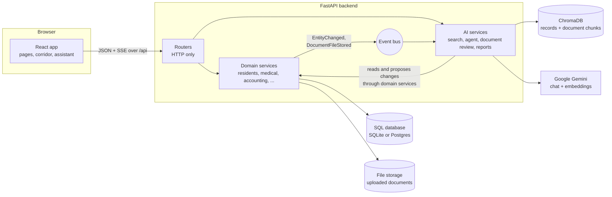
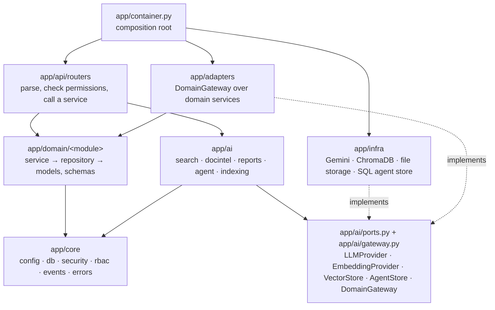
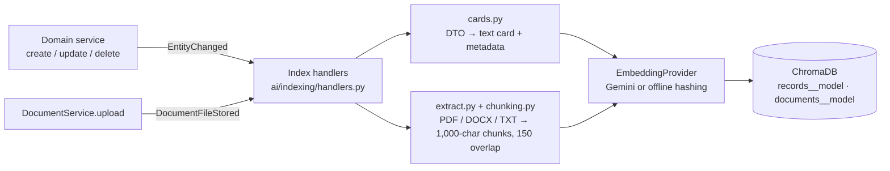
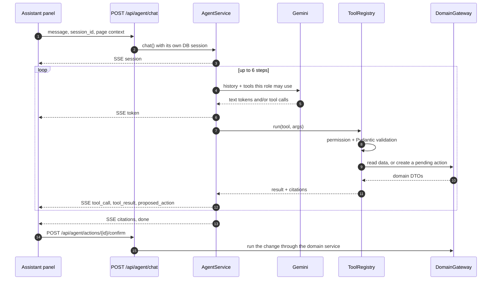
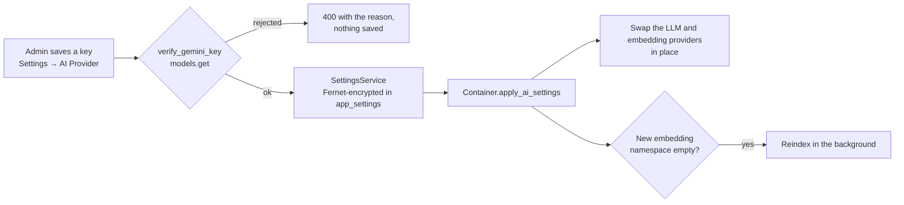
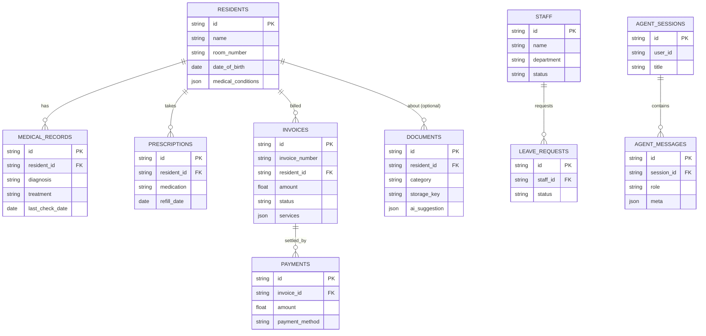
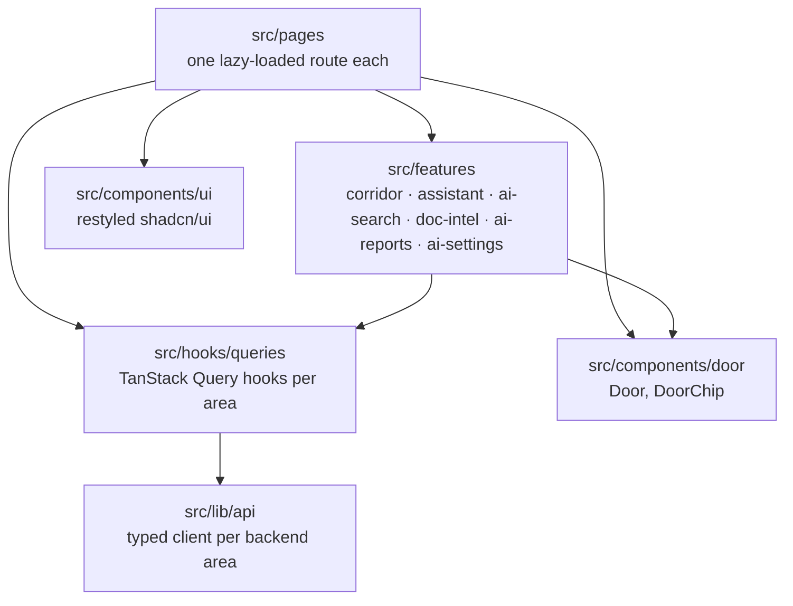
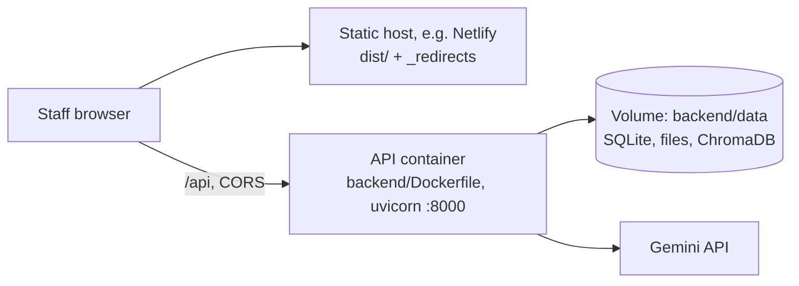

# SilverSync architecture

How the pieces fit together: the React app, the FastAPI backend, the retrieval layer (ChromaDB) and the Gemini agent. For setup and day-to-day use see the [README](README.md). For the visual design see [DESIGN.md](DESIGN.md).

- [System overview](#system-overview)
- [Backend layers](#backend-layers)
- [Request lifecycle](#request-lifecycle)
- [Access control](#access-control)
- [Retrieval: keeping the vector index in sync](#retrieval-keeping-the-vector-index-in-sync)
- [The agent](#the-agent)
- [Document review](#document-review)
- [Reports and alerts](#reports-and-alerts)
- [AI provider configuration](#ai-provider-configuration)
- [Data model](#data-model)
- [Frontend](#frontend)
- [API surface](#api-surface)
- [Deployment](#deployment)
- [Key decisions](#key-decisions)

## System overview

The domain layer knows nothing about AI. When data changes it publishes an event, and the AI layer listens and updates the vector index. The AI layer reads and changes data only through the domain services, so validation, business rules and events always apply, whether a change comes from a form or from the assistant.

## Backend layers

| Package | Responsibility | May not import |
|---|---|---|
| `app/core` | Settings, database engine, JWT and password hashing, RBAC tables, event bus, domain errors, secret encryption | anything else in the app |
| `app/domain` | One package per area (`residents`, `staff`, `medical`, `documents`, `accounting`, `reports`, `users`, `settings`). Each has `models.py`, `repository.py` (SQL only), `service.py` (rules) and `schemas.py` (DTOs). | AI, infra, FastAPI, ChromaDB, Gemini |
| `app/ai` | Search, document review, reports, agent and indexing. Depends only on ports and domain DTOs. | infra, SQLAlchemy, SDKs, repositories, ORM models |
| `app/infra` | Adapters for the ports: `GeminiLLM`, `GeminiEmbeddings`, `HashingEmbeddings` (offline), `ChromaVectorStore`, `LocalFileStorage`, `SqlAgentStore`, plus swappable provider wrappers | domain, API |
| `app/adapters` | `ServiceGateway`, the `DomainGateway` implementation over the domain services | |
| `app/api` | FastAPI routers and dependencies (`current_user`, `require(...)`) | SQLAlchemy and repositories, directly |
| `app/container.py` | Builds every concrete class once and wires them together. The only file that knows them all. | |

These rules are checked by [import-linter](https://import-linter.readthedocs.io/) (`backend/.importlinter`, run `uv run lint-imports`). Five contracts cover the "may not import" column above.

## Request lifecycle

A plain data request, for example `PATCH /api/residents/3`:

1. **Auth:** `current_user` decodes the bearer JWT and loads the user. Permissions are always derived from the role on the server, never trusted from the client.
2. **Permission:** `require("residents:update")` rejects the request with 403 if the role lacks it.
3. **Validation:** Pydantic validates the body against `ResidentUpdate`.
4. **Business logic:** the router calls `ResidentService.update`, which loads the row through the repository, applies the change and commits.
5. **Event:** the service publishes `EntityChanged("resident", id, "updated", dto)`.
6. **Response:** the router returns `{"data": ..., "error": null}`. Domain errors map to HTTP codes in one handler (`NotFoundError` → 404, `PermissionDeniedError` → 403, other `DomainError` → 400, `LLMUnavailableError` → 503).
7. **Indexing:** the event bus runs the indexing handler on a background thread pool, so the response never waits for embeddings.

## Access control

Six roles (admin, doctor, nurse, accountant, HR, receptionist) map to `module:action` permissions in `app/core/rbac.py`. The table mirrors `src/lib/rbac.ts`, so the UI and API agree.

Permissions are enforced in three places:

| Layer | How |
|---|---|
| API | `require(...)` dependencies on every route. Exports check the permission for the data being exported. |
| Retrieval | Every vector query adds `where module $in allowed_modules(user)`. A receptionist's search can never return a medical note. |
| Agent tools | The model is only shown tools the role may use, and the registry checks permissions again when it runs a tool. A confirmed action re-checks the role at confirm time. |

The UI also hides what a role can't open: sections are hidden, never shown as zero. That is for clarity only; security comes from the three layers above.

## Retrieval: keeping the vector index in sync

- **Two collections:**
  - `records` holds one text card per row: resident, staff, leave request, medical record, prescription, invoice, payment, document metadata.
  - `documents` holds chunks of uploaded file text.
- **Metadata:** every entry carries `entity_type`, `entity_id`, `module`, `title`, `url` and, where it applies, `resident_id` and `document_id`. Search filters on these.
- **Namespaces:** collection names include the embedding model (for example `records__gemini-embedding-001-768`). Switching models never mixes vectors of different sizes; the new namespace is built in the background.
- **Deletes:** deleting a row deletes its card. Deleting a resident also deletes every card and chunk tagged with that resident, because the database cascade removes their child rows without separate events.
- **Searching:** `SearchService` embeds the query (task type `RETRIEVAL_QUERY`), queries both collections with the role's module filter, sorts by cosine similarity and de-duplicates by entity.
- **Rebuilding:** `python -m app.scripts.reindex` rebuilds everything from the database.

## The agent

- **Manual tool loop:** the agent runs its own loop (`app/ai/agent/loop.py`) instead of the SDK's automatic function calling. That keeps the permission checks, streaming, auditing and confirmation step in our code. On the final step the tools are withheld, so the model has to answer.
- **Tools:** the 18 tools live in `app/ai/agent/tools/`, grouped by area.
  - Retrieval: `semantic_search`, `search_documents`.
  - Residents: `find_resident`, `get_resident_profile`.
  - Medical: `list_prescriptions_due`, `list_medical_records`, `create_medical_record`.
  - Accounting: `list_invoices`, `list_outstanding_invoices`, `get_financial_stats`, `record_payment`.
  - HR: `list_staff`, `list_leave_requests`, `update_leave_status`.
  - Documents: `list_documents`, `summarize_document`.
  - Reports: `draft_report`, `get_alerts`.
- **Human in the loop:** the three tools that change data (`create_medical_record`, `record_payment`, `update_leave_status`) never write. Each stores a pending action. Only the user who asked can confirm or reject it, and confirming runs the change through the normal domain service.
- **Memory and audit:** conversations, messages, pending actions and an audit row for every tool call are stored through `AgentStore`, implemented by `infra/sql_agent_store.py`.
- **Provider-neutral messages:** `Message`, `ToolCall` and `LLMChunk` in `ai/schemas.py` don't depend on any SDK. The Gemini adapter converts to and from them, including echoing back thought signatures between tool turns.
- **Streaming:** the endpoint returns Server-Sent Events. It opens its own database session, because the request's session closes before the stream starts. The event types are `session`, `step`, `token`, `tool_call`, `tool_result`, `proposed_action`, `citations`, `error` and `done`.

## Document review

1. **Upload:** `POST /api/documents` (multipart) checks the type (PDF, DOC, DOCX, TXT, JPG, PNG) and size (10 MB), stores the file through `FileStorage`, saves the metadata and publishes `DocumentFileStored`. The index handler then extracts and chunks the text.
2. **Analysis:** `POST /api/ai/documents/{id}/analyze` asks Gemini for structured output (a Pydantic schema): category, resident, summary and confidence. It gives Gemini the extracted text, or the file itself when there's no extractable text (scans and images). In that case it also asks for a transcript and indexes it.
3. **Validation:** the suggested resident must be one of the real residents sent with the prompt. Otherwise it's dropped. The suggestion is stored on the document.
4. **Applying it:** editors can apply the suggestion. Uploaders can also fix their own pending uploads, via the `DocumentService.can_edit` rule.

## Reports and alerts

- **Report drafts:** `ReportsService.draft(kind)` gathers the data for one of six kinds (clinical summary, refill alerts, overdue dues, financial overview, staff leave, occupancy) through the gateway. It needs both `reports:generate` and the read permission for that area. Gemini writes Markdown, and the browser exports it to PDF.
- **Alerts:** `ReportsService.alerts` is deterministic, with no AI involved. It lists refills due within 7 days, overdue invoices, pending leave and unverified documents, filtered by role, each tagged with the resident it concerns so the UI can light that door's call light.

## AI provider configuration

- **Swappable providers:** services hold `SwitchableLLM` and `SwitchableEmbeddings` wrappers, so a new key applies without rebuilding anything or restarting.
- **Precedence:** a key saved in Settings beats `GEMINI_API_KEY` from the environment. With neither, the app uses `UnconfiguredLLM`, which explains how to enable AI, and the offline `HashingEmbeddings` for search.
- **Encryption:** the key is encrypted with a key derived from `JWT_SECRET` and never returned to the browser; the API returns only the last four characters.

## Data model

- **Other tables:** `users` (email, bcrypt hash, role), `reports`, `app_settings` (key/value; secrets encrypted), `agent_actions` (pending, executed, rejected or failed) and `agent_audit` (one row per tool call).
- **Cascades:** child rows cascade when a resident or staff member is deleted. Document files are removed explicitly first.
- **Schema creation:** tables are created with `Base.metadata.create_all`. There are no migrations yet.

## Frontend

- **Data flow:** pages never call `fetch` directly. They use query and mutation hooks, which call the typed API modules.
  - Mutations invalidate the affected query families plus the dashboard, alerts and search.
  - The client throws `ApiError` with the server's message. A 401 fires an event that signs the user out.
- **Auth:** `AuthContext` stores the JWT session and refreshes the user from `/api/auth/me` on load, so permissions always come from the server.
- **Assistant:** `useAgentChat` reads the SSE stream (`streamEvents` in `lib/api/client.ts`) into chat turns with tool steps, citations and action cards. The panel and its Markdown renderer load the first time it's opened.
- **Doors:** a door's colour comes from the room number (`lib/doors.ts`), so it's stable and neighbouring doors never match. `useDoorNavigate` wraps navigation in `document.startViewTransition`:
  - A door click hands the door to the resident page as a shared element.
  - Other page changes cross-fade.
  - Without support, or under reduced motion, the page changes instantly.
- **Bundles:** routes, the assistant and the PDF library are split out. The first load is about 125 KB of gzipped JavaScript.

## API surface

All routes are under `/api` and return `{ data, error, count? }`. Interactive docs are at `/docs` when the backend runs.

| Area | Routes |
|---|---|
| Auth and users | `POST /auth/login`, `POST /auth/signup`, `GET /auth/me`, `GET /users`, `PATCH /users/{id}/role` |
| Residents | `GET/POST /residents`, `GET/PATCH/DELETE /residents/{id}` |
| Medical | `GET/POST /medical/records`, `PATCH/DELETE /medical/records/{id}`, `GET/POST /medical/prescriptions`, `GET /medical/prescriptions/due`, `PATCH/DELETE /medical/prescriptions/{id}` |
| Staff and HR | `GET/POST /staff`, `PATCH/DELETE /staff/{id}`, `GET/POST /hr/leave`, `PATCH /hr/leave/{id}` |
| Documents | `GET/POST /documents`, `GET /documents/stats`, `PATCH/DELETE /documents/{id}`, `GET /documents/{id}/file` |
| Accounting | `GET/POST /invoices`, `PATCH/DELETE /invoices/{id}`, `GET/POST /payments`, `GET /accounting/stats`, `GET /accounting/outstanding` |
| Reports | `GET /reports`, `POST /reports/{id}/generate`, `GET /export/{type}`, `GET /dashboard/summary` |
| Search | `GET /search/semantic?q=` |
| AI | `GET /ai/status`, `GET /ai/alerts`, `GET /ai/reports/kinds`, `POST /ai/reports/{kind}`, `POST /ai/documents/{id}/analyze` |
| Agent | `POST /agent/chat` (SSE), `GET /agent/sessions`, `GET /agent/sessions/{id}/messages`, `POST /agent/actions/{id}/confirm`, `POST /agent/actions/{id}/reject` |
| Settings | `GET/PUT /settings/ai`, `DELETE /settings/ai/key` |
| Health | `GET /health` |

## Deployment

- **Frontend:** the static build lives in `dist/`. `public/_redirects` serves known routes with 200 and everything else as the designed 404 page with a real 404 status.
- **API:** one container. Its image seeds an empty database on first start. Mount `backend/data` so data survives restarts, or point `DATABASE_URL` at Postgres.
- **Configuration:** set `CORS_ORIGINS`, a strong `JWT_SECRET`, and `VITE_API_URL` when the frontend is served from another origin.
- **Scaling:** the event bus and provider swap are in-process. With several API workers, a key saved in Settings applies at once in the worker that received it, and in the others after a restart. A shared queue would be the next step if indexing outgrows one process.

## Key decisions

| Decision | Why |
|---|---|
| Domain never imports AI; indexing reacts to events | The care data model stays testable and usable without any AI provider. The index can't drift from writes made anywhere. |
| AI depends on ports, not SDKs | Gemini, ChromaDB and storage can each be swapped by writing one adapter. Tests run with fakes and no network. |
| Manual tool loop with confirm-gated writes | Permission checks, audit and human approval are guaranteed in our code, not left to the model. |
| Permission checks in API, retrieval and tools | Retrieval is where data leaks into prompts. Filtering there keeps another role's records out of the model's context. |
| Embedding-model namespaces in ChromaDB | Changing provider or dimensions never corrupts the index, and switching back is instant. |
| Calendar-relative seed data | Demo refills and invoices always read as this week, so the dashboard shows realistic urgency. |
| SQLite by default | Zero setup for a single home. The SQLAlchemy URL switches it to Postgres. |
