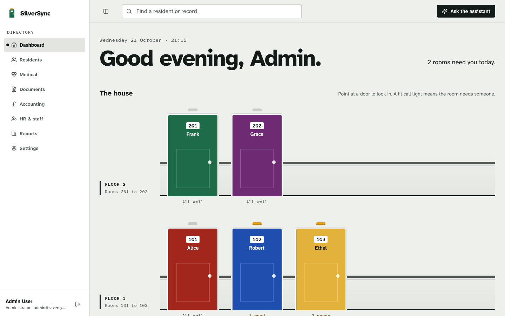
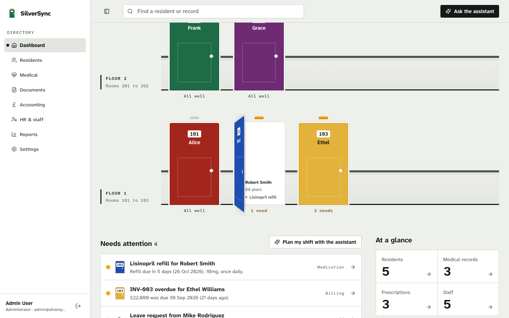
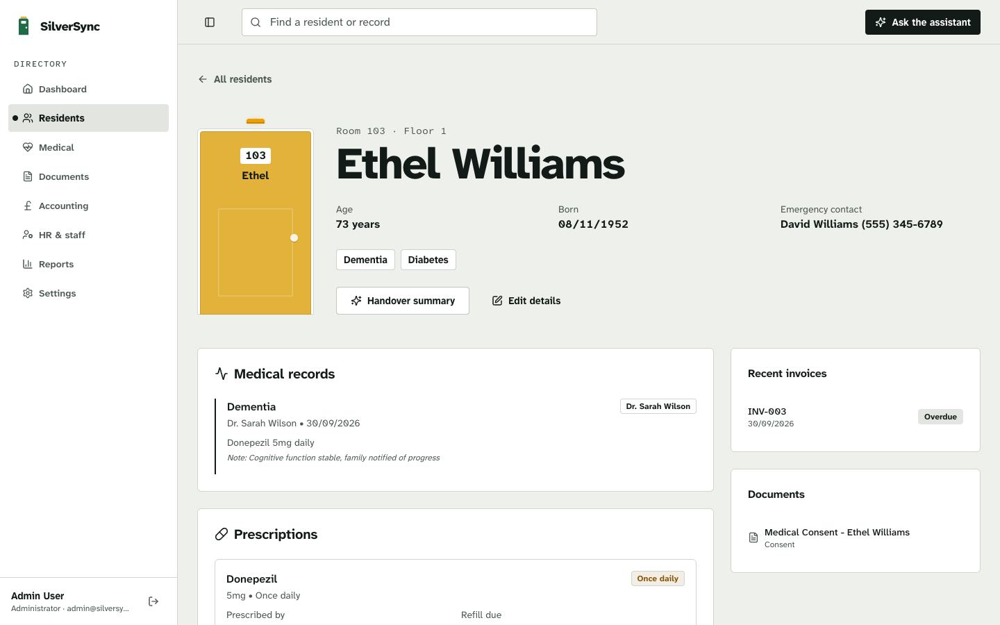
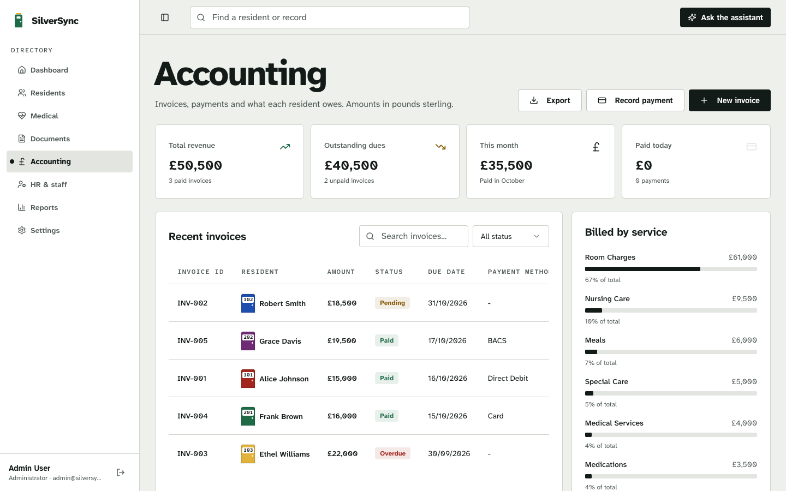
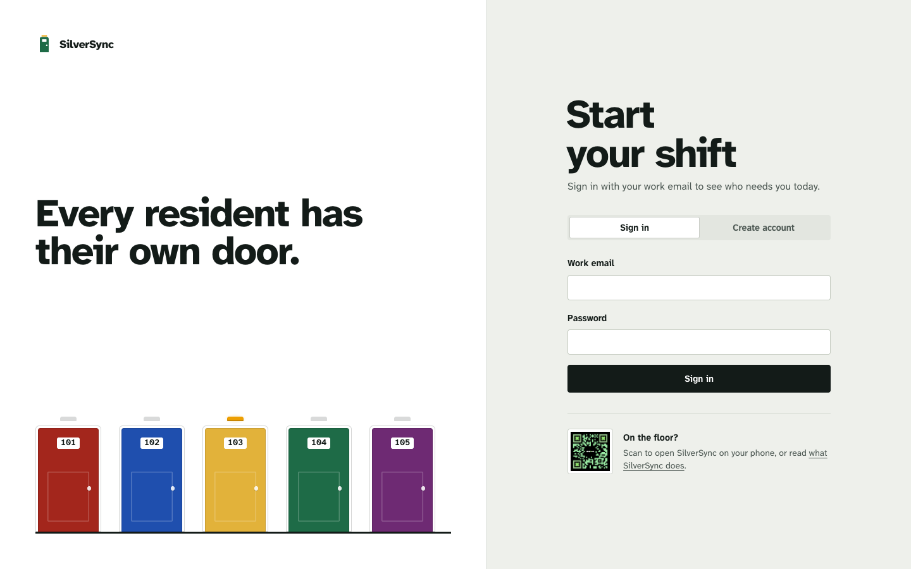
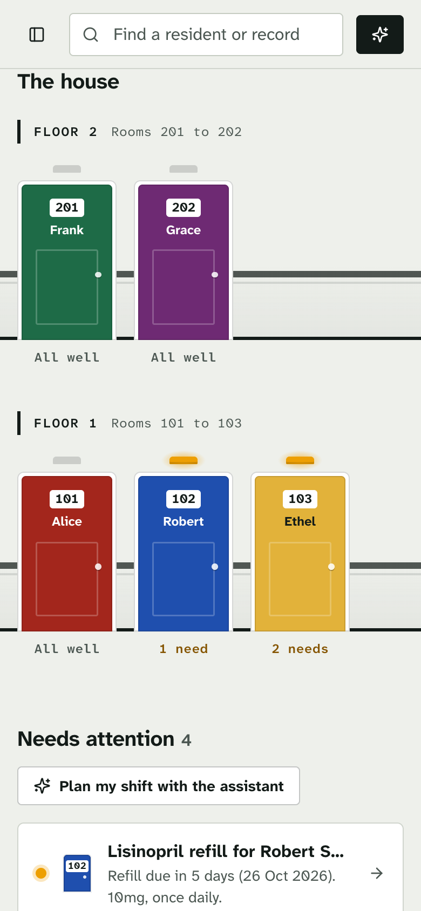

# SilverSync

**The operations app of a residential care home.** Staff see residents, medication, billing, staff and documents in one place. An AI assistant answers questions from the home's own records and drafts changes for a person to confirm.



**Docs:** [Architecture](ARCHITECTURE.md) · [Design](DESIGN.md)

Dementia-friendly care homes paint each resident's front door its own colour, with their name and room number, so they can find home. SilverSync uses the same idea: **every resident has their own door**, and that door appears wherever the resident does. The dashboard draws the house as corridors of doors. A lit nurse-call light marks rooms that need someone. Pointing at a door swings it open to show what that room needs.

| | |
|---|---|
|  |  |
| A door swings open to show what the room needs | Clicking walks through the door into the resident's page |
|  |  |
| Billing, with residents shown as door chips | Sign in |

<p align="center"></p>

## What it does

- **Residents:** profiles, rooms and floors, conditions and emergency contacts. Each resident has a stable door colour.
- **Medical:** records and prescriptions, with refills due within a week marked by a call light.
- **Accounting:** invoices, payments, outstanding dues and what each service billed, all in pounds sterling.
- **Staff & HR:** the staff directory, departments, and approving or rejecting leave.
- **Documents:** uploads (PDF, DOCX, TXT, JPG, PNG). Their text is indexed, so you can search it and ask the assistant about it.
- **Reports:** PDF reports and CSV exports, plus narrative reports drafted by the AI.
- **Roles:** admin, doctor, nurse, accountant, HR and receptionist. Each role sees only its own areas, and that holds for search and the assistant too.

### AI features

| Feature | Where | How it works |
|---|---|---|
| Assistant | **Ask the assistant** in the header | A Gemini agent with 18 tools, streamed live. It shows each step it takes and cites the records it used. |
| Changes need a person | Action cards in the assistant | New medical records, payments and leave decisions are only proposals until the person who asked confirms them. |
| Semantic search | Header search bar | Searches every record and uploaded document the user may read, by meaning rather than exact words (ChromaDB). |
| Document review | Upload dialog, Documents page | Reads the text of PDF, DOCX and TXT files, transcribes scans, and suggests a category, a resident and a summary. |
| Report drafts and alerts | Reports page, Dashboard | Markdown reports written from live data, exportable as PDF. Alerts for refills, overdue invoices and pending approvals, filtered by role. |

## Tech stack

| Layer | Tools |
|---|---|
| Frontend | React 18, Vite 5, TypeScript, TanStack Query, Tailwind CSS, Radix UI (shadcn/ui), View Transitions API |
| Backend | Python 3.11 to 3.13, FastAPI, Pydantic v2, SQLAlchemy 2 (SQLite by default, any SQLAlchemy database works), JWT auth |
| AI | Google Gemini (`google-genai`) for chat and embeddings, ChromaDB as the vector store, pypdf for text extraction |
| Type | Atkinson Hyperlegible Next and Mono, self-hosted. The Braille Institute designed them for low-vision readers. |

## Getting started

You need [uv](https://docs.astral.sh/uv/) and Node 18 or newer.

**1. Start the backend**

```bash
cd backend
cp .env.example .env
uv sync
uv run python -m app.scripts.seed --reset
uv run uvicorn app.main:app --reload --port 8000
```

The seed command loads demo data and builds the search index. API docs are at http://localhost:8000/docs.

**2. Start the frontend** (repo root, in another terminal)

```bash
npm install
npm run dev
```

Open http://localhost:8080. The dev server forwards `/api` to port 8000.

**3. Sign in** with one of the demo accounts. They all use the password set by `SEED_PASSWORD` in `backend/.env`.

| Email | Role | Can open |
|---|---|---|
| `admin@silversync.com` | Administrator | Everything, including user roles and the AI provider |
| `doctor@silversync.com` | Doctor | Residents, medical, documents, reports |
| `nurse@silversync.com` | Nurse | Residents, medical, documents |
| `accountant@silversync.com` | Accountant | Residents, accounting, documents, reports |
| `hr@silversync.com` | HR manager | Residents, staff & HR, documents, reports |
| `receptionist@silversync.com` | Receptionist | Residents, documents |

Demo dates move with the calendar: the seed shifts them to the day you run it, so refills and invoices always read as due this week.

**4. Turn on AI** (optional). Sign in as the admin, then open **Settings → AI Provider** and paste a [Google AI Studio](https://aistudio.google.com/apikey) key:
- The key is checked with Google before it's saved, stored encrypted, and never sent back to the browser.
- It takes effect without a restart.
- Search is rebuilt with Gemini embeddings in the background.
- Without a key, everything except the AI works. Search falls back to an offline keyword-style embedder.

With Docker: create `backend/.env`, then run `docker compose up --build`.

## Configuration

Backend settings live in `backend/.env` (see `backend/.env.example`):

| Variable | Default | Purpose |
|---|---|---|
| `GEMINI_API_KEY` | empty | Gemini key. A key saved in Settings takes precedence. |
| `GEMINI_CHAT_MODEL` | `gemini-flash-latest` | Chat model for the assistant, document review and report drafts |
| `GEMINI_EMBED_MODEL` | `gemini-embedding-001` | Embedding model for search |
| `EMBEDDING_DIMENSIONS` | `768` | Embedding vector size |
| `JWT_SECRET` | dev value | Signs logins and derives the key that encrypts saved API keys. **Set a long random value in production.** |
| `DATABASE_URL` | SQLite in `backend/data/` | Any SQLAlchemy URL, e.g. Postgres |
| `SEED_PASSWORD` | in `.env.example` | Password given to the demo accounts |
| `CORS_ORIGINS` | localhost:8080, 5173 | Allowed frontend origins |

Frontend settings:

| Variable | Purpose |
|---|---|
| `VITE_API_URL` | Base URL of the API when it's served from another origin (default `/api`) |
| `VITE_API_PROXY` | Where the dev server forwards `/api` (default `http://localhost:8000`) |

## Project structure

```
src/                       React app
  pages/                   one file per route (dashboard, residents, medical, documents, ...)
  features/                corridor, assistant, AI search, document review, AI reports, AI settings
  components/door/         Door and DoorChip, the resident's door at full size and at text size
  components/ui/           restyled shadcn/ui primitives
  hooks/queries/           TanStack Query hooks per area
  lib/api/                 typed API client (one module per backend area)
  index.css                design tokens and the door, corridor and motion styles
backend/
  app/domain/              residents, staff, medical, documents, accounting, reports, users, settings
  app/ai/                  search, document review, reports, agent (registry, tools, loop, actions)
  app/infra/               Gemini, ChromaDB, file storage and SQL adapters
  app/api/routers/         HTTP endpoints
  app/scripts/             seed and reindex
  tests/                   unit and integration tests (scripted fake LLM, no key needed)
ARCHITECTURE.md            how the system fits together, with diagrams
DESIGN.md                  design concept, palette, type, motion rules, decisions and QA log
```

## Architecture

The full write-up, with diagrams, is in **[ARCHITECTURE.md](ARCHITECTURE.md)**. It covers the system overview, backend layers, request lifecycle, access control, how the vector index stays in sync, the agent loop, document review, AI provider configuration, the data model, the frontend, the API surface and deployment.

In short: FastAPI routers call domain services (residents, medical, accounting and so on), which know nothing about AI and publish an event whenever data changes. The AI layer (search, agent, document review, reports) listens to those events to keep ChromaDB in sync. It reads and changes data only through the domain services, and reaches Gemini and ChromaDB only through small interfaces. `backend/.importlinter` enforces these boundaries (`uv run lint-imports`).

### Access control and safety

- **Permissions are checked in three places:** the API, search (each role only searches its own areas) and the assistant's tools. Tools a role can't use are never shown to the model, and every call is checked again when it runs.
- **Audit trail:** every tool call is logged. A change the assistant proposes is stored as pending until the user who asked confirms it.
- **No clinical advice:** the assistant summarises records and flags items for a clinician.
- **Search engines:** the app holds health records, so it's marked `noindex` and `robots.txt` blocks all crawlers.
- **Before real data:** review the Gemini API's data-use terms before using real patient data.

## Design

`DESIGN.md` has the full design brief, the concepts considered, the colours and type, the motion rules and the QA log. In short:
- **Colour:** neutral corridor walls, so colour belongs to the doors. Each door colour passes AA contrast with its label.
- **Motion:** doors swing on their hinge, and buttons fill from the hinge side. Pages cross-fade, and clicking a door turns it into the door at the top of the resident's page.
- **At rest:** only the call lights move. Under reduced motion, nothing moves and everything stays visible.

## Testing

```bash
cd backend && uv run pytest          # 49 tests; a scripted fake LLM, so no API key needed
cd backend && uv run lint-imports    # layering contracts
npx tsc --noEmit -p tsconfig.app.json
npm run build
```

Before merging, the UI was checked on a production build. Screenshots covered all 11 page types: desktop, phone, reduced motion, keyboard focus and hover. Accessibility (axe), layout shift and load times were measured too; the results are in the QA log in `DESIGN.md`.

## Deployment

- **Frontend:** `npm run build` produces `dist/`. `netlify.toml` and `public/_redirects` serve the single-page app. Unknown URLs show the designed 404 page with a real 404 status.
- **API:** `backend/Dockerfile` seeds an empty database and starts uvicorn on port 8000.
  - Put the frontend's origin in `CORS_ORIGINS`.
  - Set `VITE_API_URL` when building the frontend.
  - Set a strong `JWT_SECRET`.
- **Data:** the database, uploaded files and search index live in `backend/data/`. Mount it as a volume (docker-compose already does).
- **Multiple API workers:** a Gemini key saved in Settings applies at once in the process that received it. Other workers pick it up when they restart.

## Known limitations

- The demo data is fictional. The residents, staff and documents in `backend/app/scripts/seed_data.py` are placeholders.
- Page transitions use the View Transitions API. In browsers that lack it, pages simply change without the animation.
- Changing `JWT_SECRET` makes a saved Gemini key unreadable. Enter the key again in Settings afterwards.
